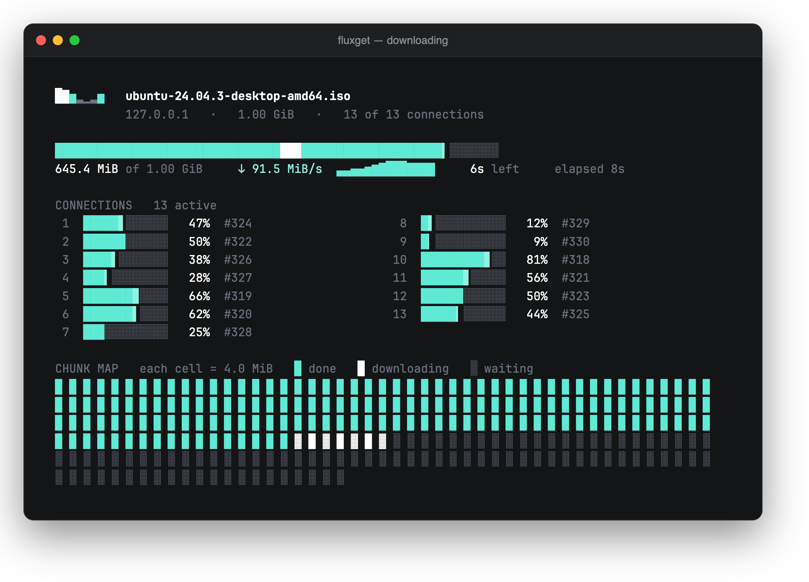
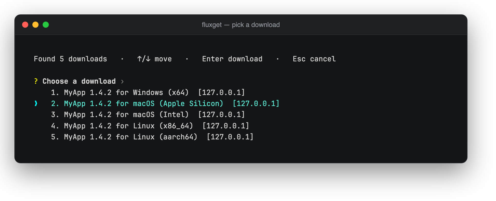
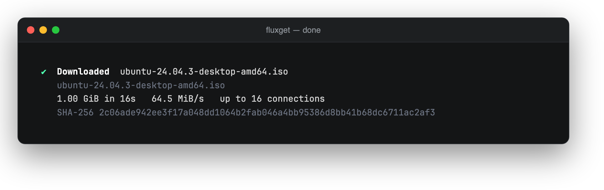
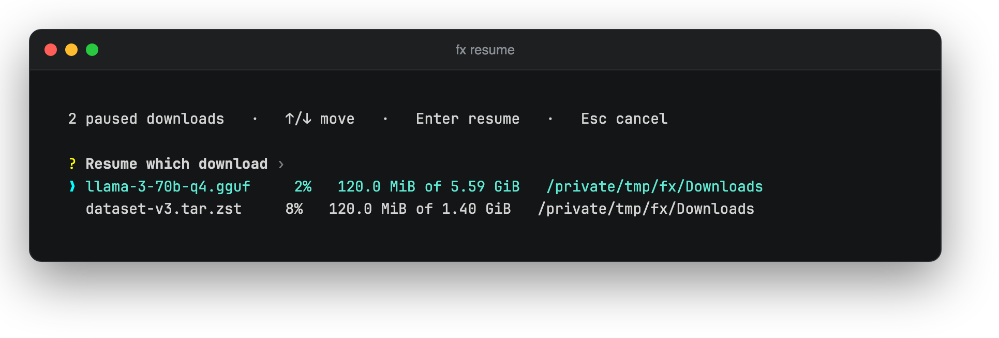
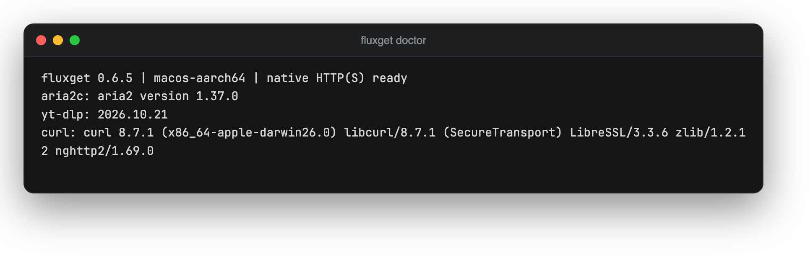
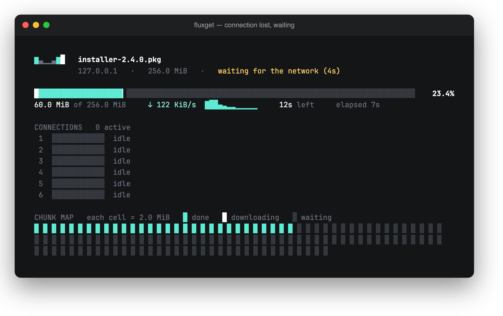
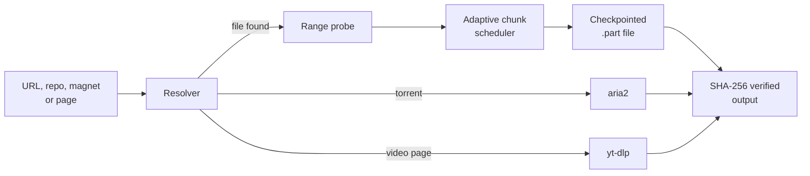

<div align="center">



<br />

# fluxget

**Adaptive, integrity-first download accelerator for Windows, macOS and Linux.**
Paste a link, a repo, a magnet or a video page. fluxget finds the file, downloads it in parallel, and proves it arrived intact.

[](https://github.com/Cosmos-0118/fluxget/actions/workflows/ci.yml)
[](https://github.com/Cosmos-0118/fluxget/releases)
[](LICENSE)


[Install](#install) ·
[Usage guide](docs/usage.md) ·
[Resume and integrity](docs/integrity.md) ·
[Development](docs/development.md) ·
[Report a bug](https://github.com/Cosmos-0118/fluxget/issues)

</div>

---

## Why fluxget

Browsers download a file over one connection and call it done. Download managers add speed but rarely tell you whether the bytes are right. fluxget is a single small binary that does both: it splits a download into chunks, tunes how many run at once while it measures the real throughput, and refuses to publish a file it cannot verify.

- **Fast, without guessing.** An adaptive controller starts small, grows while throughput improves and backs off when the server pushes back. `--fixed` and `-j` give you manual control up to 32 workers.
- **Integrity first.** Resume checks the server's validators and re-hashes saved chunks. The output only appears after the final SHA-256, and `--sha256` makes a mismatch a hard failure.
- **Understands where files live.** Paste a GitHub repo, a Hugging Face model, a SourceForge project, an archive.org item or a Drive link and pick the file you want. Published hashes are verified automatically.
- **Resumable and resilient.** Interrupt at any point, or lose the network: fluxget saves its progress, waits for the connection to return and continues where it stopped. After a crash, `fx resume` lists everything that is paused and carries on from the verified chunks.
- **Scriptable.** `--json`, `--quiet`, stable exit codes and a non-interactive `resolve` command for pipelines.
- **One installer, same command to update.** No Rust, Python or admin rights required.

## Features

| | |
| --- | --- |
| **Parallel engine** | Native Rust HTTP(S) with HTTP/2, bounded dynamic chunk scheduling, retries with backoff and `Retry-After`, proxies (HTTP and SOCKS) and custom headers. |
| **Adaptive workers** | Starts at four, measures throughput every 500 ms, grows by 1.5x while it helps and rolls back when it does not. Default ceiling 16, configurable to 32. |
| **Live display** | An overall bar with speed, ETA and a throughput sparkline, one lane per connection and a map of every chunk. Adapts to the window and disappears when the transfer ends. |
| **Smart resolver** | Reads a page for file links, `download` attributes, `<video>` sources and redirects. Multiple candidates open an arrow-key picker with your OS and CPU preselected. |
| **Source adapters** | GitHub, GitLab, Codeberg/Gitea/Forgejo, Hugging Face, SourceForge, archive.org, Google Drive, Dropbox, OneDrive, Pixeldrain and VS Code. |
| **Validated resume** | Byte-range probes, `If-Match` or `If-Unmodified-Since` on every chunk, atomic checkpoints and per-chunk SHA-256. |
| **Network recovery** | Continues a broken chunk from the byte where it stopped, waits out connection loss (`--patience`, default 5 minutes) and saves progress on Ctrl-C, `SIGTERM` or a closing terminal. |
| **Torrents and media** | Magnet links and `.torrent` files go to [aria2](https://aria2.github.io/); YouTube and similar sites go to [yt-dlp](https://github.com/yt-dlp/yt-dlp). |
| **Folder picker** | Choose where each download goes with the system folder dialog, or let it land in your Downloads folder. |
| **Cross-platform** | Prebuilt packages for Windows, macOS and Linux on x86_64 and aarch64. |

## Screenshots

<table>
  <tr>
    <td align="center" width="50%">
      <br />
      <sub><b>Pick from a page.</b> Your OS and CPU is highlighted.</sub>
    </td>
    <td align="center" width="50%">
      <br />
      <sub><b>Verified result.</b> Size, speed, connections and SHA-256.</sub>
    </td>
  </tr>
</table>

<table>
  <tr>
    <td align="center" width="50%">
      <br />
      <sub><b>Resume anything.</b> <code>fx resume</code> finds every paused download.</sub>
    </td>
    <td align="center" width="50%">
      <br />
      <sub><b>Doctor.</b> Shows which optional backends are installed.</sub>
    </td>
  </tr>
</table>

<table>
  <tr>
    <td align="center">
      <br />
      <sub><b>Connection lost?</b> fluxget keeps its progress, waits, and carries on when the network returns.</sub>
    </td>
  </tr>
</table>

<sub>Screenshots are real runs of the current build against a local loopback test server, so the host reads 127.0.0.1 and the speeds are not an internet measurement.</sub>

## Install

No Rust, Python or admin account is needed. The installer picks your OS and CPU, downloads the latest release, checks its SHA-256, verifies the executable and installs it for your user. Open a new terminal afterwards and run `fluxget --help`.

**Windows (PowerShell):**

```powershell
irm https://raw.githubusercontent.com/Cosmos-0118/fluxget/main/install.ps1 | iex
```

**macOS or Linux (Terminal):**

```sh
curl -fsSL https://raw.githubusercontent.com/Cosmos-0118/fluxget/main/install.sh | bash
```

> [!TIP]
> **Already installed? Run the same command again to update.** A failed download, checksum or version check leaves your current binary untouched, and your downloads and resume checkpoints are preserved.

Prefer clicking? Download a package from [Releases](https://github.com/Cosmos-0118/fluxget/releases/latest), extract it and double-click **Install.cmd** (Windows) or **Install.command** (macOS). Custom directories and pinned versions are in [docs/installation.md](docs/installation.md). To build from source see [Build from source](#build-from-source).

The installer also adds **`fx`**, a short alias: `fx https://example.org/archive.zip` works the same as `fluxget`.

## Use it

```sh
fluxget https://example.org/archive.zip                      # download to your Downloads folder
fluxget https://example.org/archive.zip -o downloads/a.zip   # choose the output
fluxget https://example.org/archive.zip --sha256 <hash>      # fail unless the hash matches
fluxget github.com/BurntSushi/ripgrep                        # pick a release asset, hash-verified
fluxget https://huggingface.co/org/model                     # pick a model file
fluxget 'magnet:?xt=urn:btih:...' -o ~/torrents              # torrent via aria2
fluxget https://www.youtube.com/watch?v=ID -o ~/videos       # video via yt-dlp
fluxget inspect https://example.org/archive.zip              # probe ranges, size and validators
fluxget resume                                               # pick a paused download to continue
```

**Where files go.** Without `-o`, a terminal run asks where to save, with your Downloads folder preselected or the system folder picker one keypress away. Piped, `--json` and `--quiet` runs skip the question. A name already taken becomes `name (1).ext` unless you pass `--force`.

**Scripting.** `--json` prints one result object with the strategy, SHA-256, elapsed time and peak worker count. `fluxget resolve URL --json` lists candidates with a stable order and `--select N` chooses one, so it never needs a terminal.

The full option reference, source details, tuning and error behaviour are in the [usage guide](docs/usage.md).

## Supported sources

Listings use each site's documented public API, so there is no scraping or login. A published SHA-256 is verified automatically whenever the site provides one.

| Source | What you can paste | Result |
| --- | --- | --- |
| **GitHub** (and Enterprise) | repo, `/releases`, `/releases/latest`, a tag, `/blob/...`, `/tree/REF` | release assets with **verified digests**, source archives, raw files |
| **GitLab**, **Codeberg/Gitea/Forgejo** | releases pages or the repo root | release assets and source archives |
| **Hugging Face** | model or dataset page, `/tree`, `/blob` | every file, LFS files with **verified SHA-256** |
| **SourceForge** | project page | best release per platform, **verified SHA-256** |
| **archive.org** | `/details/ID` | original files first, then derivatives |
| **Google Drive / Docs**, **Dropbox**, **OneDrive**, **Pixeldrain** | public share links | direct download, Docs offer DOCX/XLSX/PPTX/PDF |
| **Torrents** | magnet links, `.torrent` URLs or files, pages with either | downloaded with aria2 |
| **Video and audio pages** | YouTube, Vimeo, X, Instagram, TikTok, Reddit, Twitch, SoundCloud, Bandcamp and more | downloaded with yt-dlp |
| **VS Code** | `code.visualstudio.com` | all official builds, listed instantly |

Not possible natively: MEGA (end-to-end encrypted), Google Drive folders, and anything behind a login. See the [usage guide](docs/usage.md#supported-sources) for tokens, rate limits and caveats.

## How it works



- **Probe first.** A real byte-range request decides whether the file can be segmented. `Accept-Ranges` alone is not trusted.
- **Adaptive, not reckless.** Workers grow only while measured throughput improves, and shrink on throttling. The number of chunks bounds useful workers, so a small file never opens thousands of requests.
- **Guarded chunks.** Every chunk carries the strongest precondition the server offers (`If-Match` or `If-Unmodified-Since`). Servers with neither get their start, middle and end re-fetched and compared before the file is published.
- **Safe publish.** Progress lives in `name.fluxget.part` and a versioned `name.fluxget.json` checkpoint. The final file appears only after the SHA-256 is computed and, if you gave one, checked.

The details, including the checkpoint format and failure behaviour, are in [Resume and integrity](docs/integrity.md).

### Benchmarks

Measured on a Windows 11 machine against a deterministic loopback server, with SHA-256 checked on every output. This scenario gives each connection a synthetic 4 MiB/s cap, like a server that throttles single streams.

| Tool | Median MiB/s |
| --- | ---: |
| curl (single connection) | 4.00 |
| fluxget `--single-stream` | 3.98 |
| fluxget adaptive (default) | 10.53 |
| fluxget `--fixed -j 8` | 30.17 |
| aria2 `-x8` | 30.92 |

Loopback is not an internet speed test, small files finish before the controller learns much, and with no per-connection cap curl is faster on loopback. No universal speedup is claimed. The raw runs, commands and caveats are in [docs/BENCHMARK_WINDOWS.md](docs/BENCHMARK_WINDOWS.md).

## Architecture

| Area | Source | What it does |
| --- | --- | --- |
| CLI and commands | [`src/main.rs`](src/main.rs) | Argument parsing and the `get`, `resume`, `inspect`, `resolve`, `doctor`, `aria2`, `media` and `winget` commands. |
| Download engine | [`src/engine.rs`](src/engine.rs) | Chunk scheduling, adaptive worker control, retries and verification. |
| HTTP layer | [`src/http.rs`](src/http.rs) | Probes, redirects, proxies and range requests. |
| Resume state | [`src/state.rs`](src/state.rs), [`src/paused.rs`](src/paused.rs) | Checkpoints, locks and the list of paused downloads. |
| Resolver and sources | [`src/resolver.rs`](src/resolver.rs), [`src/sites.rs`](src/sites.rs), [`src/forges.rs`](src/forges.rs) | Page scanning, URL recognition and release-API adapters. |
| Terminal UI | [`src/ui.rs`](src/ui.rs), [`src/picker.rs`](src/picker.rs), [`src/location.rs`](src/location.rs) | Live display, arrow-key picker and the save-location prompt. |
| Backends | [`src/backends.rs`](src/backends.rs) | Argument-vector delegation to aria2 and yt-dlp. No shell is ever involved. |

## Build from source

Install [Rust 1.91 or newer](https://rustup.rs). Windows also needs the Visual Studio C++ Build Tools and macOS needs the Xcode command line tools. TLS uses rustls, so OpenSSL is not required.

```sh
git clone https://github.com/Cosmos-0118/fluxget.git
cd fluxget
cargo install --path . --locked
fluxget doctor
```

Or build a portable binary with `cargo build --release --locked`; it lands in `target/release/fluxget`.

### Test

```sh
cargo fmt --all -- --check
cargo clippy --locked --all-targets -- -D warnings
cargo test --locked
python scripts/integration.py --binary target/release/fluxget
```

The integration scripts run against loopback servers, so no internet or external tools are required. The full list, including benchmarks and packaging, is in [docs/development.md](docs/development.md).

## Documentation

| Guide | Contents |
| --- | --- |
| [Usage guide](docs/usage.md) | Every option, source adapters, torrents and media, tuning and JSON output. |
| [Installation](docs/installation.md) | Custom directories, pinned versions, updates and package options. |
| [Resume and integrity](docs/integrity.md) | Probes, validators, checkpoints and what is verified. |
| [Development](docs/development.md) | Building, tests, benchmarks and packaging. |
| [Research notes](docs/RESEARCH.md) | Alternatives considered and the decisions made. |
| [Windows benchmark](docs/BENCHMARK_WINDOWS.md) | Recorded results and methodology. |

## Roadmap

Working now: native HTTP(S), validated resume, adaptive workers, the live display, source adapters, cloud share links and torrent and media delegation.

Planned: native mirror striping, batch scheduling, aggregate rate limiting, cookie jars and login-gated sites, JavaScript-rendered listings, a native BitTorrent engine and a browser extension.

## Contributing

Bug reports, ideas and pull requests are welcome. Please run the checks under [Test](#test) before you submit and open an issue first for larger changes.

## Licence

fluxget is released under the [MIT License](LICENSE). Third-party notices are in [THIRD_PARTY_NOTICES.txt](THIRD_PARTY_NOTICES.txt). aria2 and yt-dlp are separate projects that you install yourself and keep their own licences.

## Release and checksums

<details>
<summary>Direct downloads and how to verify them</summary>

<br />

The installer verifies checksums for you. If you download a package by hand, compare it with the values below. They are the same values published next to each archive on the release page, and they detect corruption but rely on the GitHub release as the trusted source.

<!-- This block is rewritten by the release workflow (scripts/update_readme_release.py). Do not edit it by hand. -->
<!-- release-info:start -->
- **Latest release:** [fluxget 0.7.0](https://github.com/Cosmos-0118/fluxget/releases/tag/v0.7.0)
- **Downloads and SHA-256 checksums:**

  | Platform | File | SHA-256 |
  | --- | --- | --- |
  | Windows x86_64 (Intel/AMD) | [`fluxget-windows-x86_64.zip`](https://github.com/Cosmos-0118/fluxget/releases/download/v0.7.0/fluxget-windows-x86_64.zip) | `b8817c8bec17e0049280266641fe26dc811180af94bbdedca6a03bc0121b0ad1` |
  | Windows aarch64 (ARM) | [`fluxget-windows-aarch64.zip`](https://github.com/Cosmos-0118/fluxget/releases/download/v0.7.0/fluxget-windows-aarch64.zip) | `f1e43b6f15a1c41e15900fb142df7320915c05fb748bfb6612742effd5af920b` |
  | macOS x86_64 (Intel/AMD) | [`fluxget-macos-x86_64.tar.gz`](https://github.com/Cosmos-0118/fluxget/releases/download/v0.7.0/fluxget-macos-x86_64.tar.gz) | `3fdb3014bea8c629c07fe903dffff5b043a17df09db71ab9b8cebe5ed39912fc` |
  | macOS x86_64 (Intel/AMD) | [`fluxget-macos-x86_64.zip`](https://github.com/Cosmos-0118/fluxget/releases/download/v0.7.0/fluxget-macos-x86_64.zip) | `9e05ef796d9e9aa488f2468d7541ef16ac81799ab29672f5b759e3ea939f2620` |
  | macOS aarch64 (ARM) | [`fluxget-macos-aarch64.tar.gz`](https://github.com/Cosmos-0118/fluxget/releases/download/v0.7.0/fluxget-macos-aarch64.tar.gz) | `a5dc026e6ad2d98f279f7ee98ac88b9282852ced06f32d3a6b3b2b875f1fd775` |
  | macOS aarch64 (ARM) | [`fluxget-macos-aarch64.zip`](https://github.com/Cosmos-0118/fluxget/releases/download/v0.7.0/fluxget-macos-aarch64.zip) | `1f76761f31fda1b8a697239f94fe7275775571c391fa2ac4eed452601b56e10e` |
  | Linux x86_64 (Intel/AMD) | [`fluxget-linux-x86_64.tar.gz`](https://github.com/Cosmos-0118/fluxget/releases/download/v0.7.0/fluxget-linux-x86_64.tar.gz) | `673be06ffa551b888efc492c4661cbb38af20ff2688ab903dc467a2276279faa` |
  | Linux x86_64 (Intel/AMD) | [`fluxget-linux-x86_64.zip`](https://github.com/Cosmos-0118/fluxget/releases/download/v0.7.0/fluxget-linux-x86_64.zip) | `081b43eeadc3a4b34a2de165fcaff00500197d950d4cbdeefa550f8346a01340` |
  | Linux aarch64 (ARM) | [`fluxget-linux-aarch64.tar.gz`](https://github.com/Cosmos-0118/fluxget/releases/download/v0.7.0/fluxget-linux-aarch64.tar.gz) | `fca97a0081676845aebf5713ac589f08fe5d279ef321e133ba23aceb0b2da7a1` |
  | Linux aarch64 (ARM) | [`fluxget-linux-aarch64.zip`](https://github.com/Cosmos-0118/fluxget/releases/download/v0.7.0/fluxget-linux-aarch64.zip) | `7c7113547c59f40977f7bf01f0a57e9f6d141cfb7ead6110ecd25c1d4b39abb1` |

  Every archive also has a `.sha256` file on the release page.

- **Verify locally** (run it in the folder you downloaded to):

  ```sh
  echo '3fdb3014bea8c629c07fe903dffff5b043a17df09db71ab9b8cebe5ed39912fc  fluxget-macos-x86_64.tar.gz' | shasum -a 256 -c
  ```

  On Windows, PowerShell prints `True` when the file is genuine:

  ```powershell
  (Get-FileHash .\fluxget-windows-x86_64.zip -Algorithm SHA256).Hash -eq 'b8817c8bec17e0049280266641fe26dc811180af94bbdedca6a03bc0121b0ad1'
  ```
<!-- release-info:end -->

</details>

---

<div align="center">
<sub>Made as a hobby project. If fluxget saves you time, a star helps others find it.</sub>
</div>
